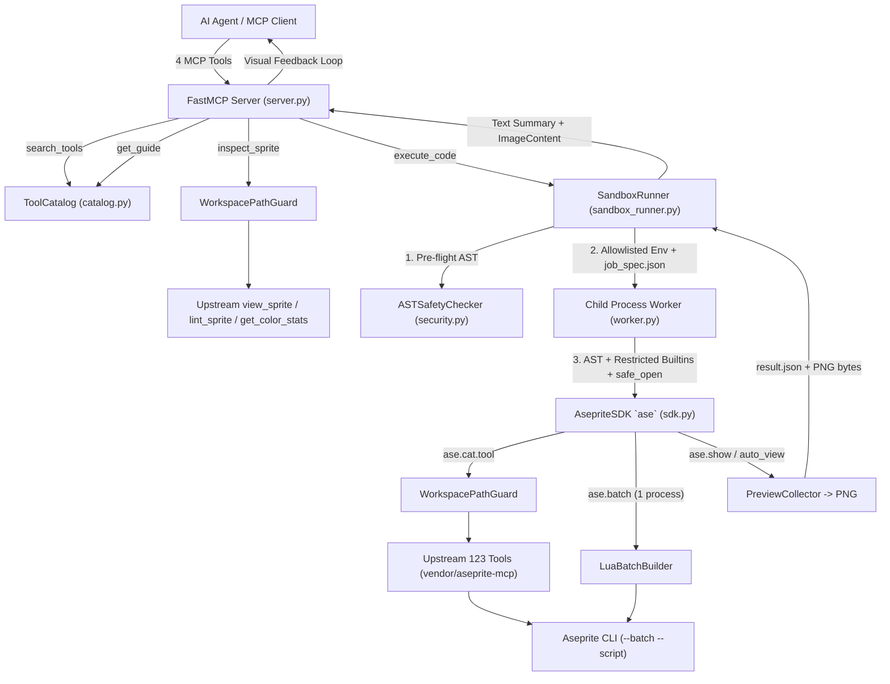

# Plan & Specification: `aseprite-codemode` (Agentic Code Execution cho `diivi/aseprite-mcp`)

## 1. Hướng thiết kế được đề xuất & So sánh kiến trúc

Thay vì ép AI gọi từng tool trong bộ **123 MCP tools** của `diivi/aseprite-mcp`, dự án áp dụng kiến trúc **Hybrid Agentic Code Execution ("Code Mode")**:

| Tiêu chí | Pure MCP (123 tools gốc) | Pure Lua (`run_lua_script` đơn lẻ) | **Hybrid Code Mode (`aseprite-codemode`)** *(Được chọn)* |
|---|---|---|---|
| **Số lượng MCP tools expose** | 123 tools | 1–2 tools | **4 tools cố định** (`search_tools`, `execute_code`, `inspect_sprite`, `get_guide`) |
| **Token khởi tạo (Context footprint)** | Rất lớn (~20k+ tokens schema) | Nhỏ nhất | **Rất nhỏ** (~800 tokens), tra cứu SDK theo nhu cầu (*progressive disclosure*) |
| **Vòng lặp & logic phức tạp** | Phải gọi LLM nhiều lượt (chậm, tốn token) | 1 lượt, nhưng AI dễ sai API Lua Aseprite | **1 lượt duy nhất** bằng Python (`for`, tính toán màu, procedural) |
| **Guardrails & Pixel-art helpers** | Có sẵn (`draw_rows`, `lint_sprite`, `generate_color_ramp`, `FIND_LAYER`, `NORMALIZE_CEL`) | Phải tự viết lại bằng Lua | **Kế thừa 100%** helper đã kiểm chứng từ `diivi/aseprite-mcp` (không trùng code) |
| **Hiệu năng tiến trình Aseprite** | 1 tiến trình `aseprite --batch` / 1 tool call | 1 tiến trình / script | Hỗ trợ cả hai: gọi `ase.<cat>.<tool>` **và** gộp nhiều lệnh vào **1 tiến trình** qua `ase.batch(...)` |
| **Bảo mật & Cách ly** | Kiểm tra traversal cơ bản, lộ toàn bộ host cho Lua | Rủi ro chạy code tự do trực tiếp trên host | **Subprocess + AST check + Restricted builtins + `WorkspacePathGuard` + Env allowlist** |

**Nguyên tắc cốt lõi:** Không sửa code gốc của `diivi/aseprite-mcp`. Upstream được clone nguyên bản vào `vendor/aseprite-mcp` (hoặc trỏ qua `ASEPRITE_MCP_REPO`) và được nạp động để vừa giữ khả năng cập nhật upstream, vừa tái sử dụng toàn bộ 123 tools qua SDK Python đồng bộ `ase`.

---

## 2. Kiến trúc tổng thể & Luồng dữ liệu



### Danh sách module trong `src/aseprite_codemode/`

1. **`config.py`**: Đọc cấu hình từ `.env`, biến môi trường và overrides (`RuntimeConfig`), kiểm tra và clamp `code_timeout_seconds` trong `[1.0, 300.0]`.
2. **`loader.py`**: Nạp động gói `aseprite_mcp` từ `vendor/aseprite-mcp` (hỗ trợ nạp lazy khi chạy trong worker để không tốn thời gian import 21 module nếu không dùng) mà không expose server `aseprite_mcp.mcp` gốc.
3. **`security.py`**:
   - `WorkspacePathGuard`: Chuẩn hóa đường dẫn và ràng buộc mọi thao tác đọc/ghi vào `workspace_dir` (chặn `..`, ổ đĩa khác, UNC, `~/...`, ký tự NUL, raw file descriptor, symlink thoát workspace).
   - `ASTSafetyChecker`: Chặn import ngoài whitelist `SAFE_IMPORT_MODULES` (thuần Python stdlib — không cho phép import `aseprite_codemode`), chặn `eval`/`exec`/`compile`/`__import__`/`getattr`/`setattr`/`delattr`/`globals`/`locals`/`vars`, chặn truy cập dunder `__*__`.
   - `build_sanitized_env`: Tạo biến môi trường chỉ giữ biến OS thiết yếu + biến cấu hình `ASEPRITE_*`, loại bỏ toàn bộ API key/secret của máy chủ.
   - Policy flags: `PREVIEW_SERVER_TOOLS`, `RAW_LUA_TOOLS`, bảng phân loại `PATH_PARAM_NAMES` / `CONDITIONAL_PATH_PARAM_NAMES` / `NON_PATH_PARAM_NAMES`.
4. **`catalog.py`**: Quét động toàn bộ tool đã đăng ký trên upstream `FastMCP` (hỗ trợ cả `ToolCatalog.for_category` lazy theo từng module), tìm kiếm đa từ khóa có xếp hạng và 3 mức chi tiết (`summary`, `signature`, `full`), mặc định `limit=12` và ẩn `categories` khi truy vấn đã có bộ lọc để tiết kiệm token.
5. **`sdk.py`**:
   - `AsepriteSDK` + `create_sandbox_sdk`: Cung cấp proxy cô lập qua closure (chặn truy cập `_private` attributes như `_upstream_pkg`/`_guard`/`_allow_raw_lua`) cho mọi category (`ase.canvas`, `ase.drawing`, `ase.animation`, ...), kèm `ase.strict = True` (mặc định raise `AsepriteToolError` khi tool upstream trả chuỗi lỗi), `ase.path`, `ase.list_files`, `ase.show`, `ase.batch`, `ase.run_lua`, `ase.help`.
   - `LuaBatchBuilder`: Gom nhiều thao tác (`add_layer`, `add_frame(empty=...)`, `set_frame_duration`, `set_tag`, `draw_pixels`, `draw_line`, `draw_rect`, `draw_ellipse`, `draw_rows`, `outline`, `clear_cel`, `set_palette`) với mã Lua dạng bảng dữ liệu gọn (không unroll từng pixel) vào một `app.transaction(...)` duy nhất để chạy trong 1 tiến trình `aseprite --batch --script`.
   - `PreviewCollector`: Thu thập đối tượng `fastmcp.Image` từ `view_sprite` / `ase.show` thành file PNG cho phản hồi thị giác và phân biệt trạng thái `captured` vs `limit_reached`.
6. **`worker.py`**: Tiến trình con chạy script người dùng/AI trong namespace bị giới hạn (`__builtins__` tối giản + `guard.safe_open` + `_safe_import` + `ase` proxy), nạp lazy từng category khi cần, tự động chạy `auto_view` nếu có, xuất `result.json`.
7. **`sandbox_runner.py`**: Snapshot thư mục workspace trước/sau để thống kê `files_created` & `files_modified`, tiêu diệt toàn bộ cây tiến trình (gồm `aseprite.exe` con qua `taskkill /T /F` trên Windows / `killpg` trên POSIX) khi hết timeout, thu thập `tool_warnings`, cắt ngắn stdout/stderr vượt ngưỡng `max_output_chars`.
8. **`server.py` & `__main__.py`**: Khởi tạo `FastMCP("aseprite-codemode")` độc lập chỉ đăng ký đúng 4 tools qua stdio, khóa đồng bộ theo `(workspace_dir, loop)` cho `execute_code` / `inspect_sprite`, cô lập `ASEPRITE_PATH` theo scope lock thay vì mutate `os.environ` toàn cục, và chạy các kiểm tra của `inspect_sprite` song song ngoài event loop.

---

## 3. Input, Output & Specification chi tiết

### 3.1. MCP Tool 1: `search_tools`

Tìm kiếm các hàm có trong SDK `ase` theo danh mục hoặc từ khóa.

- **Input:**
  | Tham số | Kiểu | Mặc định | Mô tả |
  |---|---|---|---|
  | `query` | `str` | `""` | Các từ khóa cách nhau bởi dấu cách (vd: `"draw rows"`, `"palette ramp"`) |
  | `category` | `str` | `""` | Tên module upstream (vd: `"drawing"`, `"animation"`, `"palette"`) |
  | `detail` | `"summary" \| "signature" \| "full"` | `"signature"` | Độ chi tiết kết quả trả về |
  | `limit` | `int` | `12` | Số tool tối đa (giới hạn `1..150`) |

- **Output (`str` JSON):**
  *(Trường `"categories"` chỉ trả về khi cả `query` và `category` đều rỗng để tối ưu token.)*
  ```json
  {
    "total_tools": 123,
    "matched": 2,
    "showing": 2,
    "tools": [
      {
        "sdk_call": "ase.drawing.draw_rows",
        "name": "draw_rows",
        "category": "drawing",
        "summary": "Draw pixels from rows of characters, like ASCII art: one character per pixel.",
        "policy": "allowed",
        "signature": "ase.drawing.draw_rows(filename: str, layer_name: str, frame_index: int, x: int, y: int, rows: list[str], legend: dict[str, Any], outline: str | None = None, create_if_missing: bool = True)"
      }
    ]
  }
  ```

### 3.2. MCP Tool 2: `execute_code`

Thực thi mã Python trong sandbox với đối tượng `ase` đã nạp sẵn.

- **Input:**
  | Tham số | Kiểu | Mặc định | Mô tả |
  |---|---|---|---|
  | `code` | `str` *(bắt buộc)* | — | Mã Python sử dụng `ase.*`, `open()` (trong workspace), các thư viện chuẩn an toàn |
  | `timeout_seconds` | `float` | `60.0` | Timeout tiến trình worker (clamp về `[1.0, 300.0]`) |
  | `auto_view` | `str` | `""` | Tên file `.aseprite` tự động render ảnh PNG sau khi script chạy xong |
  | `view_frames` | `str` | `""` | Phạm vi frame cho `auto_view` (vd: `"1-4"`) |
  | `view_layer` | `str` | `""` | Tên layer cho `auto_view` |
  | `view_region` | `str` | `""` | Vùng crop `"x,y,w,h"` cho `auto_view` |
  | `view_scale` | `int` | `0` | Độ phóng đại (`0` = tự động) |

- **Output (`list[TextContent, ImageContent...]`):**
  - Phần tử đầu tiên là JSON summary:
    ```json
    {
      "status": "ok | error | security_error | timeout",
      "duration_ms": 420,
      "stdout": "...",
      "stderr": "...",
      "return_value": {"frames": 4},
      "files_created": ["slime.aseprite"],
      "files_modified": [],
      "previews": [
        {"index": 1, "label": "slime.aseprite", "source_tool": "view_sprite", "text": "...", "bytes": 4120}
      ],
      "tool_warnings": [],
      "error": null,
      "error_type": null,
      "traceback": null
    }
    ```
  - Các phần tử tiếp theo (nếu có `auto_view` hoặc script gọi `ase.show(...)` / `ase.view.view_sprite(...)`): `Image(data=<png>, format="png")`.

### 3.3. MCP Tool 3: `inspect_sprite`

Kiểm tra chất lượng sprite chỉ đọc trong **1 tiến trình Aseprite CLI duy nhất** (`--sheet` + `--list-layers` + `--list-tags`) kết hợp phân tích Pillow trong bộ nhớ và ghép strip ảnh chẩn đoán.

- **Input:**
  | Tham số | Kiểu | Mặc định | Mô tả |
  |---|---|---|---|
  | `filename` | `str` *(bắt buộc)* | — | Đường dẫn file sprite trong workspace |
  | `frames` | `str` | `""` | Chuỗi frame cần xem (vd: `""`, `"2"`, `"1-4"`; bỏ qua nếu đặt `tag`) |
  | `layer_name` | `str` | `""` | Lọc theo tên layer |
  | `region` | `str` | `""` | Vùng crop `"x,y,w,h"` |
  | `scale` | `int` | `0` | Độ phóng đại (`0` = auto) |
  | `include_lint` | `bool` | `true` | Chạy `compute_frame_lint` phát hiện detached/lone/orphan pixels |
  | `include_colors` | `bool` | `true` | Chạy `compute_frame_colors` + kiểm tra `palette_drift_colors` qua từng frame |
  | `tag` | `str` | `""` | Chọn nhanh phạm vi frame theo tag animation (vd: `"walk"`, `"idle"`) |
  | `background` | `str` | `"checker"` | Nền render: `"checker"`, `"dark"`, `"light"`, `"mid"` hoặc hex `"#RRGGBB"` |
  | `include_qa_strip` | `bool` | `true` | Ghép dải ảnh chẩn đoán `1x native`, `grayscale (value)`, `silhouette` |
  | `check_motion` | `bool` | `false` | Tính `motion.ground_line` (`bottom_y`), `adjacent_diffs`, `seam_diff` và ghép `seam` onion-skin |

- **Output (`list[TextContent, ImageContent?]`):**
  - JSON report chứa `status` (`"ok" | "error" | "security_error"`), `filename`, `inspected_frames`, `analyzed_frame_index`, `view_summary`, `sprite_info`, `per_frame` (bounds, color count, palette drift, lint counts), `lint`, `color_stats`, và `motion` (khi bật `check_motion`).
  - Đính kèm `Image` PNG có thước tọa độ và QA strip.

### 3.4. MCP Tool 4: `get_guide`

Cung cấp hướng dẫn ngắn gọn theo nhu cầu.

- **Input:** `topic: str = "overview"` (`"overview" | "pixel_art" | "animation" | "idle" | "environment" | "batch_lua" | "security"`).
- **Output:** Chuỗi văn bản hướng dẫn (kế thừa trực tiếp `INSTRUCTIONS` và `animation_workflow_guide` của `diivi/aseprite-mcp`).

### 3.5. Python `ase` SDK bên trong `execute_code`

- `ase.Grid` (`PixelGrid`): Canvas 2D thuần Python (`.rect`, `.line`, `.ellipse`, `.flood_fill`, `.draw_rows`, `.stamp`, `.replace`, `.outline`, `.shift`, `.flip_x`, `.flip_y`, `.crop`, `.bounds`, `.bottom_y`, `.count_by_char`, `.to_rows`).
- `ase.<category>.<tool>(*args, **kwargs)`: Gọi đồng bộ mọi tool upstream; tự động áp dụng `apply_defaults()`, đính kèm chữ ký mong đợi nếu `TypeError`, kiểm tra đường dẫn qua `WorkspacePathGuard`, và mặc định (`ase.strict = True`) raise `AsepriteToolError` nếu tool trả chuỗi lỗi (đặt `ase.strict = False` để ghi vào `tool_warnings`).
- `ase.batch(filename, create_size=None)`: Context manager / builder chạy tất cả thao tác trong **1 tiến trình Aseprite duy nhất**:
  - `.add_layer(name, group="")`
  - `.set_layer_props(layer, opacity=None, visible=None, stack_index=None)`
  - `.add_frame(count=1, duration_ms=None, empty=False)`
  - `.set_frame_duration(frame, duration_ms)`
  - `.set_tag(name, from_frame, to_frame, direction="forward")`
  - `.copy_cel(layer, src_frame, dst_frame)`
  - `.shift_cel(layer, frame, dx, dy)`
  - `.replace_color(layer, frame, old_color, new_color)`
  - `.fill_area(layer, frame, x, y, color)`
  - `.draw_pixels(layer, frame, pixels)`
  - `.draw_line(layer, frame, x1, y1, x2, y2, color, thickness=1)`
  - `.draw_rect(layer, frame, x, y, w, h, color, filled=True)`
  - `.draw_ellipse(layer, frame, cx, cy, rx, ry, color, filled=True)`
  - `.draw_rows(layer, frame, x, y, rows, palette)`
  - `.outline(layer, frame, color="#000000", include_diagonals=False)`
  - `.clear_cel(layer, frame)`
  - `.set_palette(colors)`
  - `.add_raw_lua(lua_snippet)` *(chỉ khi `ASEPRITE_ALLOW_RAW_LUA=1`)*
  - `.commit()` -> `{"ok": bool, "operations": int, "output": str}`
- `ase.copy(src, dst, overwrite=False) -> str`
- `ase.read_grid(filename, x=0, y=0, width=0, height=0, frame_index=1, layer_name="") -> dict`
- `ase.show(filename, frames="", layer_name="", region="", scale=0) -> str`
- `ase.path(rel) -> str`
- `ase.list_files(glob_pattern="**/*") -> list[str]`
- `ase.run_lua(script, filename="") -> str` *(chỉ khi `ASEPRITE_ALLOW_RAW_LUA=1`)*
- `ase.help(query="", category="", detail="signature", limit=12) -> dict`

### 3.6. Biến môi trường cấu hình

| Biến | Mặc định | Ý nghĩa |
|---|---|---|
| `ASEPRITE_PATH` | `aseprite` | Đường dẫn file thực thi `aseprite.exe` |
| `ASEPRITE_WORKSPACE` | `<repo>/workspace` | Thư mục sandbox chứa toàn bộ file làm việc |
| `ASEPRITE_TIMEOUT_SECONDS` | `60` | Timeout cho mỗi lệnh gọi Aseprite CLI |
| `ASEPRITE_CODE_TIMEOUT_SECONDS` | `60` | Timeout cho toàn bộ script trong `execute_code` (clamp `1..300`) |
| `ASEPRITE_ALLOW_RAW_LUA` | `0` | Bật/tắt `run_lua_script`, `ase.run_lua`, `batch.add_raw_lua` |
| `ASEPRITE_ALLOW_PREVIEW_SERVER` | `0` | Bật/tắt `start_preview_server` / `stop_preview_server` |
| `ASEPRITE_WARM_WORKER` | `0` | Bật/tắt chế độ warm worker giữ tiến trình Python để giảm độ trễ khởi động |
| `ASEPRITE_MCP_REPO` | `<repo>/vendor/aseprite-mcp` | Đường dẫn tùy chọn tới repo `diivi/aseprite-mcp` |

---

## 4. Những điểm cần lưu ý & Guardrails quan trọng

1. **Ranh giới Sandbox (Defense-in-Depth vs Container):**
   - Lớp bảo vệ Python (`ASTSafetyChecker`, `restricted __builtins__`, `WorkspacePathGuard`, `build_sanitized_env`) bảo vệ tốt khi dùng với agent thông thường và chặn hầu hết các vector vượt thoát thông qua Python/path.
   - Tuy nhiên, nếu chạy prompt không tin cậy (*untrusted multi-tenant* hoặc nội dung web có nguy cơ prompt injection cao), vẫn nên chạy server/Aseprite bên trong Docker container chỉ mount `workspace/` (đặc biệt nếu bật `ASEPRITE_ALLOW_RAW_LUA=1`, vì Lua của Aseprite có thư viện `io`/`os` riêng không qua AST Python).
2. **Tắt mặc định các tool rủi ro (`ASEPRITE_ALLOW_RAW_LUA=0`, `ASEPRITE_ALLOW_PREVIEW_SERVER=0`):**
   - `start_preview_server` mở HTTP server chạy nền trên host nên bị khóa mặc định.
   - `run_lua_script` cho phép chạy Lua tùy ý có quyền `os.execute`/`io.open` nên bị khóa mặc định.
3. **Bắt buộc có Visual Feedback Loop:**
   - LLM viết code vẽ pixel rất dễ lệch tọa độ hoặc chồng lớp sai nếu không nhìn lại kết quả. Luôn dùng `auto_view="file.aseprite"` ở `execute_code`, hoặc gọi `ase.show(...)`, hoặc kết thúc mỗi pass bằng `inspect_sprite(...)` để nhận PNG kèm thước tọa độ và báo cáo `lint_sprite`.
4. **Đặc thù trên Windows & Aseprite Headless CLI:**
   - Đường dẫn Windows có thể khác hoa/thường ổ đĩa hoặc chứa `\`; luôn dùng `.resolve()` trước `.is_relative_to()` và truyền `PYTHONIOENCODING=utf-8`, `PYTHONUTF8=1` để tránh lỗi encoding khi Lua/Aseprite in log.
   - Khi mở file qua `aseprite --batch`, Aseprite Lua dùng **chỉ số frame 1-based** (`spr.frames[1]`), tọa độ pixel 0-based, và `cel.image` dùng **tọa độ cel-local** (vì vậy `ase.batch` luôn gọi `normalize_cel` trước khi vẽ).
   - Bên trong `app.transaction(function() ... end)` của Aseprite Lua, lệnh `return` chỉ thoát closure chứ không thoát script ngoài; `LuaBatchBuilder` dùng biến `batch_err` để kiểm tra trước khi gọi `spr:saveAs(...)`.
5. **Pin dependency `mcp>=1.6.0,<2`:**
   - `diivi/aseprite-mcp` dùng `from mcp.server.fastmcp import FastMCP` (API của `mcp` v1.x). Nếu cài `mcp>=2.0`, module `mcp.server.fastmcp` bị xóa/đổi tên thành `MCPServer` và không import được upstream nguyên bản. Do đó `pyproject.toml` pin `<2`.
6. **Hiệu năng `ase.batch` vs `ase.<cat>.<tool>`:**
   - Mỗi lời gọi `ase.drawing.draw_pixels(...)` hay `ase.canvas.add_layer(...)` tách lẻ sẽ spawn 1 tiến trình `aseprite.exe --batch` mới (~100–300ms/lần).
   - Khi cần tạo nhiều layer, frame, hoặc vẽ nhiều vùng lặp lại, hãy gom vào `with ase.batch(filename) as b:` để giảm từ N tiến trình xuống còn **1 tiến trình duy nhất**.
7. **Đồng bộ upstream an toàn:**
   - Khi cập nhật `vendor/aseprite-mcp`, chạy `pytest tests/unit/test_catalog.py`. Test `test_all_upstream_path_params_are_classified` sẽ kiểm tra toàn bộ tham số của tất cả tool mới/cũ và báo lỗi ngay nếu upstream thêm một tham số đường dẫn mới chưa được khai báo trong `PATH_PARAM_NAMES`.

---

## 5. Kế hoạch triển khai & Ma trận Test Case

### Giai đoạn triển khai
- **Giai đoạn 1 — Khởi tạo & Upstream:** Tạo project tại `C:\projects\aseprite-codemode`, clone `diivi/aseprite-mcp` vào `vendor/aseprite-mcp`, cài đặt qua `uv sync --dev` với `mcp<2`.
- **Giai đoạn 2 — Core Security & Catalog:** Xây dựng `config.py`, `loader.py`, `security.py`, `catalog.py`; audit toàn bộ 123 tools và 167 tên tham số.
- **Giai đoạn 3 — SDK, Sandbox & Server:** Xây dựng `sdk.py` (`ase` + `LuaBatchBuilder` + `PreviewCollector`), `worker.py`, `sandbox_runner.py`, `server.py` (đúng 4 tools).
- **Giai đoạn 4 — Test & Tài liệu:** Viết tài liệu spec + bộ Unit Tests và Integration Tests chạy thật trên `aseprite.exe`.

### Ma trận Unit Test & Integration Test

| File test | Phạm vi kiểm thử | Điều kiện chạy |
|---|---|---|
| `tests/unit/test_config.py` | Giá trị mặc định, env override, fallback timeout âm/NaN, clamp `[1, 300]`, parse boolean | Luôn chạy (không cần Aseprite) |
| `tests/unit/test_security.py` | `WorkspacePathGuard` (traversal `..`, `foo..bar`, ổ đĩa khác, `~/`, NUL, raw FD, symlink escape), `ASTSafetyChecker` (import cấm, `eval`/`exec`, dunder, cú pháp lỗi), `build_sanitized_env` (lọc API key) | Luôn chạy |
| `tests/unit/test_catalog.py` | Phát hiện đủ 123 tools / 21 categories, tìm kiếm đa từ khóa, 3 mức `detail`, **audit 100% tham số đường dẫn upstream** | Luôn chạy |
| `tests/unit/test_sdk.py` | Bridge sync/async (cả trong/ngoài event loop), rewrite & chặn path escape, `font` có điều kiện, policy gate `preview_server` & `raw_lua`, thu ảnh `PreviewCollector`, sinh Lua của `LuaBatchBuilder` | Luôn chạy (mock upstream/CLI) |
| `tests/unit/test_sandbox.py` | Chạy subprocess thật: `stdout`/`stderr`/`result`, theo dõi `files_created`/`files_modified`, chặn `open("../...")`, chặn `import os`, timeout `while True`, cắt output vượt ngưỡng, xử lý exception | Luôn chạy |
| `tests/unit/test_server.py` | Xác nhận server expose **đúng 4 tools**, kiểm tra `search_tools`, `get_guide`, `execute_code` bị chặn AST, `inspect_sprite` chặn traversal | Luôn chạy |
| `tests/integration/test_real_aseprite.py` | Chạy E2E với `aseprite.exe` thật: (1) `execute_code` + `generate_color_ramp` + `draw_rows` + `outline_cel` + `auto_view` trả PNG hợp lệ; (2) `ase.batch(..., create_size=(16,16))` 1 tiến trình + `inspect_sprite`; (3) Vòng lặp Python tạo animation 4 frame + `ase.show` | Chạy khi có `ASEPRITE_PATH` hợp lệ |
